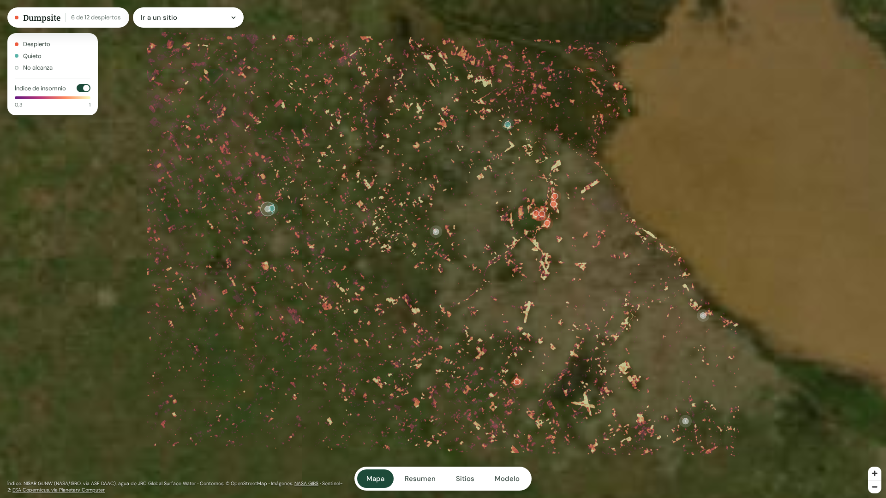
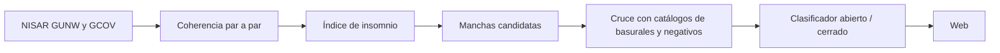
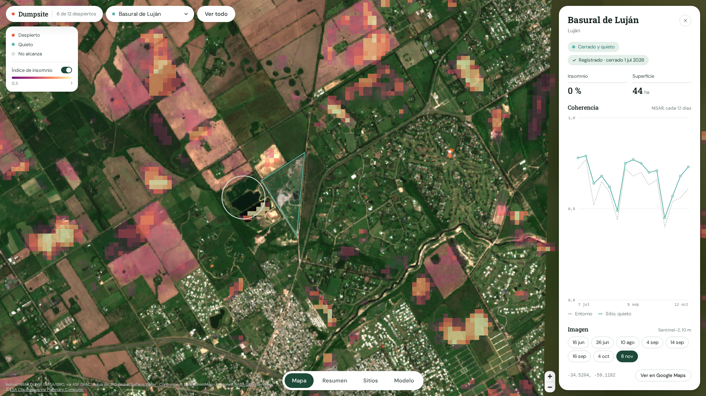
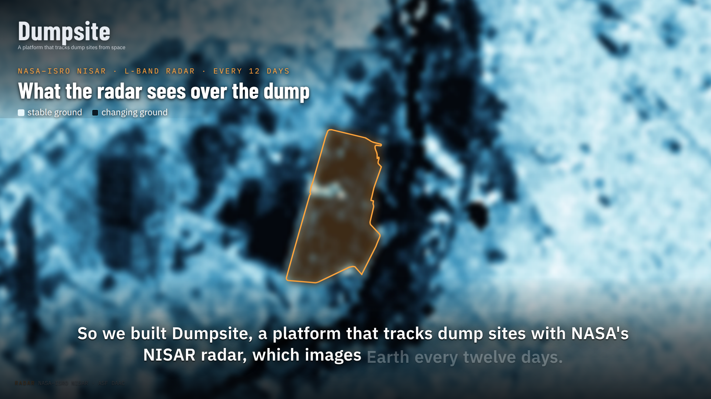

# Dumpsite

**Los basurales que el radar NISAR nunca ve quietos.** Proyecto para el challenge *Dancing with the SARs* de NASA Space Apps 2026.



## El problema y la idea
- En Argentina se estiman unos 5.000 basurales a cielo abierto y no hay un inventario abierto que diga cuáles siguen activos.
- NISAR pasa cada 12 días. Un basural activo pierde **coherencia** en todas las pasadas, porque lo remueven todos los días. Una ciudad o un campo, no.
- Dumpsite mide cuántas veces un lugar "no durmió" (el **índice de insomnio**), lo cruza con 66.981 basurales del mundo y da un veredicto contra el registro oficial.
- **Caso Luján:** cerrado el 1/07/2026, el radar lo ve **quieto en los 15 pares**. Norte III, el relleno activo del AMBA, sale despierto.

## Cómo funciona


| Ficha de un sitio | Panel del modelo | Video |
|---|---|---|
|  |  |  |

**Resultados:** 30 frames de NISAR y 962 pares. El modelo de abierto contra cerrado, que usa sólo radar, da **AUC 0,91** en frames que no vio. Detalle y límites en [`docs/resultados.md`](docs/resultados.md).

## Estructura del repo
| Carpeta | Qué hay |
|---|---|
| [`docs/`](docs/README.md) | La idea, el índice, el modelo, los resultados y los datos |
| [`web/`](web/README.md) | La web: mapa, fichas y panel del modelo (React, Vite, MapLibre) |
| [`motor/`](motor/README.md) | El pipeline de NISAR, los modelos, los tests y la infra de la VM (Python) |
| [`video/`](video/README.md) | Los dos videos de la entrega (Remotion) |
| [`data/`](data/README.md) | Catálogos de basurales y negativos, y las salidas del motor |

## Cómo correrlo
```bash
# web
cd web && npm install && npm run dev

# motor
cd motor && python -m venv .venv && .venv/bin/pip install -r requirements.txt
.venv/bin/python -m pytest tests -q
```

## Equipo
| Nombre | GitHub |
|---|---|
| Nicolás Priotto | [@nicopriotto](https://github.com/nicopriotto) |
| Santiago Bassi | [@santiagoBassi](https://github.com/santiagoBassi) |
| Ezequiel Testoni | [@EzequielTestoni](https://github.com/EzequielTestoni) |
| Juan Ignacio Lategana | [@JuaniGit](https://github.com/JuaniGit) |
| Filipo Ardenghi | [@fardenghi](https://github.com/fardenghi) |
| Agustín Tomas Romero | [@sanrome](https://github.com/sanrome) |

## Fuentes y datos
NISAR (NASA/ISRO, vía ASF DAAC), Sentinel-2 (Copernicus), OpenStreetMap vía Overture, EPA LMOP, Climate TRACE, NASA EMIT y JRC: el detalle y las licencias están en [`docs/datos.md`](docs/datos.md).
