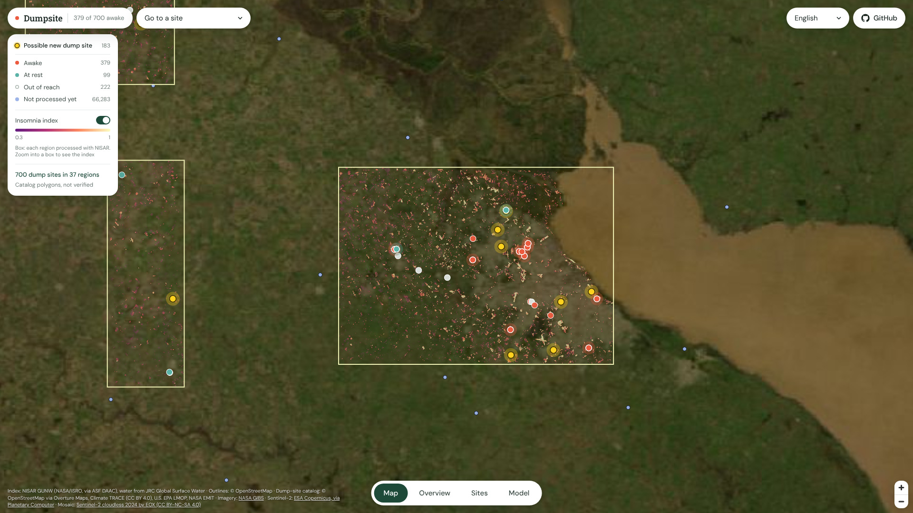
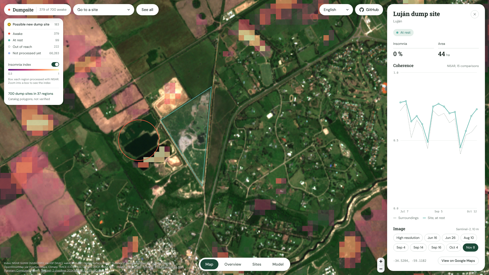
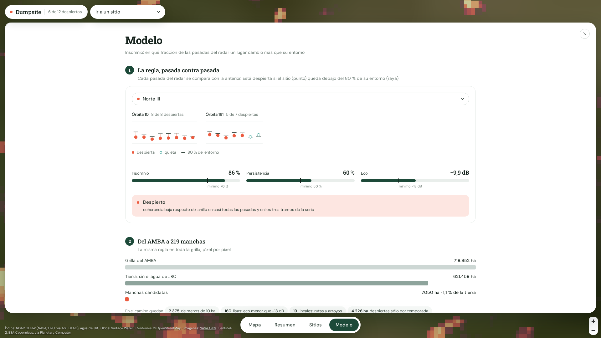

# Dumpsite

**The dump sites the NISAR radar never sees asleep.** A project for the *Dancing with the SARs* challenge of NASA Space Apps 2026.



## The problem and the idea
- Argentina has an estimated 5,000 open-air dump sites, and there's no open inventory saying which ones are still active.
- NISAR passes every 12 days. An active dump site loses **coherence** in every pass, because it gets moved around every day. A city or a field doesn't.
- Dumpsite measures how often a place "didn't sleep" (the **insomnia index**), crosses it with 66,981 dump sites around the world and gives a verdict against the official registry.
- **The Luján case:** closed on 1 July 2026, the radar sees it **quiet in all 15 pairs**. Norte III, the AMBA's active landfill, comes out awake.

## How it works


| Site card | Model panel | Video |
|---|---|---|
|  |  |  |

**Results:** 37 NISAR frames (7 of them in Argentina outside the AMBA) and 1,087 pairs. The radar finds 379 of 700 dump sites awake, and the model flags 183 possible new ones not in any catalog (not verified). The open-versus-closed model, which uses radar only, gets **AUC 0.91** on frames it didn't see. Details and limits in [`docs/results.md`](docs/results.md) and [`docs/argentina.md`](docs/argentina.md).

## Roadmap
Built in two days, so several pieces are first versions. Next steps, in short:
- **Trust what exists:** human review of the AI labels and flagged cases, calibration outside Buenos Aires, reproducible runs and a public deploy.
- **Better model:** longer NISAR series, small sites, less US bias in the training labels and calibrated scores.
- **Operational tool:** automatic monitoring every 12 days, alerts when a closed site wakes up, and field validation with authorities.

Full roadmap in [`docs/roadmap.md`](docs/roadmap.md).

## Repo structure
| Folder | What's in it |
|---|---|
| [`docs/`](docs/README.md) | The idea, the index, the model, the results, Argentina and the data |
| [`web/`](web/README.md) | The web: map, site cards and model panel (React, Vite, MapLibre) |
| [`motor/`](motor/README.md) | The NISAR pipeline, the models, the tests and the VM infra (Python) |
| [`video/`](video/README.md) | The two submission videos (Remotion) |
| [`data/`](data/README.md) | Dump-site and negative catalogs, and the engine's outputs |

## How to run it
```bash
# web
cd web && npm install && npm run dev

# engine
cd motor && python -m venv .venv && .venv/bin/pip install -r requirements.txt
.venv/bin/python -m pytest tests -q
```

## Team
| Name | GitHub |
|---|---|
| Nicolás Priotto | [@nicopriotto](https://github.com/nicopriotto) |
| Santiago Bassi | [@santiagoBassi](https://github.com/santiagoBassi) |
| Ezequiel Testoni | [@EzequielTestoni](https://github.com/EzequielTestoni) |
| Juan Ignacio Lategana | [@JuaniGit](https://github.com/JuaniGit) |
| Filipo Ardenghi | [@fardenghi](https://github.com/fardenghi) |
| Agustín Tomas Romero | [@sanrome](https://github.com/sanrome) |

## Sources and data
NISAR (NASA/ISRO, via ASF DAAC), Sentinel-2 (Copernicus), OpenStreetMap via Overture, EPA LMOP, Climate TRACE, NASA EMIT and JRC: details and licenses in [`docs/data.md`](docs/data.md).
